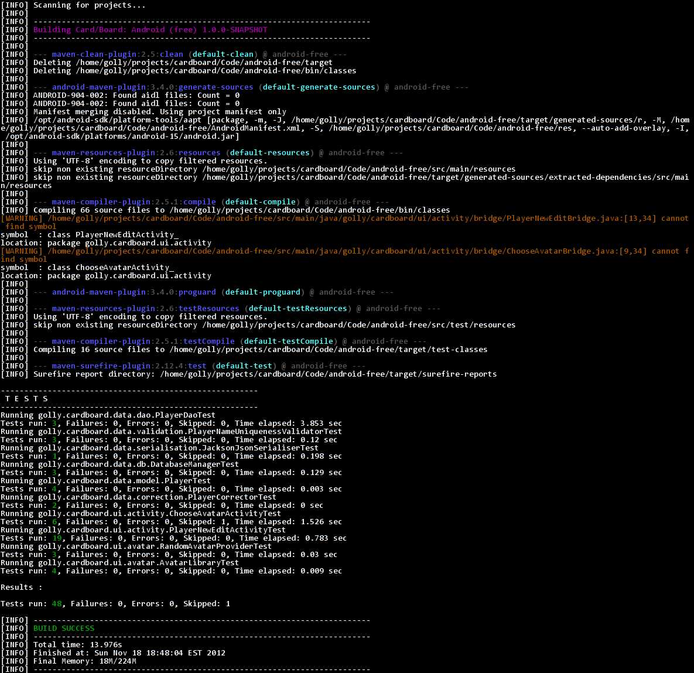
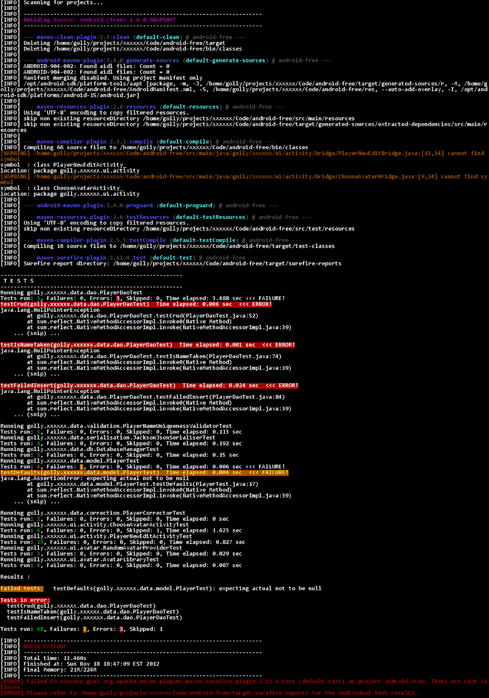

Maven.

I'm an command-line kinda guy. GUIs didn't event exist when I was a kid. When I use Maven it's often from the command-line. A curious thing happens when you run Maven from the CLI more than 3 times in a row. You slowly lose the ability to read those useful little symbols that we affectionately refer to as "the alphabet", your eyes begin to ache and you start to wonder who's really in control: you or your eyelids, the list oozes on. The reason for this is that you get a lot of information as the build runs, and more importantly it's all the same colour, usually bright white on black depending on your terminal config. Things get really hard to see and it takes a lot of precious concentration and brain-juice to decipher the results. Usually this is because you're searching for 1 particular line out of 100 or so with no real visual hints. I don't like it. My brain may well just be getting old or maybe I'm just working too much lately but I find that I don't really have much brainpower to spare, especially when you're in the middle of a problem with a large context. Don't like it.

So I wrote a script.
Get it here: [https://gist.github.com/4104053](https://gist.github.com/4104053)

The great thing about Linux is that you can treat nearly everything as either a file (like `/dev` and `/proc`, awesome!) or a **pipeline**. By simply piping Maven output through a processor (while being careful not to block) you can apply colour all over the place by using some smart regex to insert strings that the terminal parses in order to allow user control over various terminal attributes, in this case: colour. _(See [ANSI escape codes](http://en.wikipedia.org/wiki/ANSI_escape_code) on Wikipedia for more info.)_ Now I'm not the [first](http://www.ensor.cc/2012/02/colorized-maven-output-on-mac-osx.html) [person](https://github.com/builddoctor/maven-antsy-color) to [take](https://gist.github.com/1027800) [this](http://blog.blindgaenger.net/colorize_maven_output.html) approach, but the great thing is that because these scripts are so easy to write, anyone can create or customise one for their own personal needs.

My script uses said approach to do the following:

- Clear the screen before running.
- Highlight the name of each Maven phase and the plugin & goal responsible.
- Colour the number of test passes, failures, errors.
- Colour the test classes & methods of test failures and errors.
- Colour Maven warnings & errors.
- Highlight total build success / failure.
- Remove that bunch of shit you get at the end of failed Maven builds. When Maven fails (or tests fail) it dumps a bunch of info that basically amounts to "_Try using -e or -X else here's our website._" Ok for beginners maybe but I don't need to see it all the time. I have "`mvn -help`" and Google if I need them.

Now that feature-set might not sound like much but makes **a world** of difference. It turns my frown upside down. Twice! _(Hey...but that means-_

Here are some screenshots:

_Coloured Maven when things are happy_

_Coloured Maven when things go wrong_

