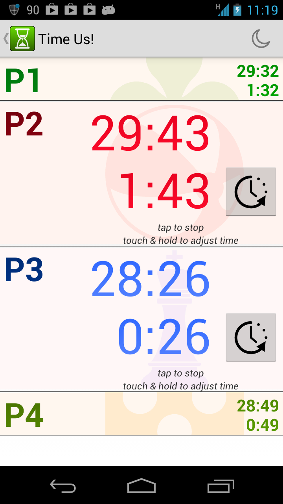

Hi. Recently I released my second Android app. It's a collection of game timers and bells and whistles to be used whilst playing board games, card games, party games, the like. Practically, that means you can use it to play 4 player Scrabble where each player has 2 minutes-per-turn and a total of 25 min for the entire game, for example. Or, for a game like Scattegories you can have an hourglass set to run for a random amount of time between 1~2 min and then scare the crap out of everyone when it goes off. That kind of thing.

If you're interested, you can peruse [some screenshots here](http://imgur.com/a/lF9dB) and find the app here: [“Time Us!”](https://play.google.com/store/apps/details?id=com.beardedlogic.gametimers)

Moving on, I'd like to share and record for future-me, the lessons I learned and observations I made whilst creating this app.

## Scale Bitmaps Effeciently

Those tiny graphic files in your resources consume a surprising amount of memory when in use. A 100KB PNG is compressed and when loaded can comsume 10MB of memory as a Bitmap. As we know memory is quite important on mobile devices, especially on older devices. If the user is on a small LDPI device for example, their tired old phone isn't going to have much memory to spare. If you're scaling bitmaps there's a chance that you're consuming more memory that you need to, and the amount of waste gets higher with older devices where it matters more.

Say you have a large graphic that you scale to a smaller size, you're going to find that without some special options in-place, the device will load the full graphic into memory and retain it as it was loaded prior to scaling. I originally assumed that on a small LDPI device the graphic would scale down to about 20% (or whatever) of its size and accordingly only consume 20% of the full size in memory. Right? No. By default Android loads first, scales later and doesn't let go of that full-sized bitmap.

So how can you reduce memory consumption? The first recommended solution (because it is more processor-performant as well) is to prepare different copies of your graphics for each density. Ok great, but there are scenarios where that's not the best approach so what then? It turns out that there's a whole trove of info on this issue online in the official Android docs, the specifics on this scaling issue here:<br />
<http://developer.android.com/training/displaying-bitmaps/load-bitmap.html>

You can mostly just copy-and-paste the utility code from the link above. By applying the methods therein, I was able to reduce memory usage by up to 80% or so (from memory), depending on the device. I didn't know this page existed until I needed it so I suggest you bookmark it and/or keep a mental note if you don't read the above page immediately.

## Free Bitmap Memory Manually

Now that we know a little more about bitmap memory consumption, let's talk about another snag I encountered.

My app's home screen has two looks: dark & light. The light-mode background consists of 2 images. On a w360dp XHDPI phone, it consumes 5.8MB for bkgd img #1, and 4.0MB for #2, making a total of 9.8MB.

_(FYI: You can easily see the memory profile of, and analyse your app by doing this from Eclipse: DDMS → Devices → Select process and click “Dump HPROF file” in the toolbar.)_

What would you expect to happen to that 9.8MB when the user hits a button and the app moves on to the next activity (screen)? I expected that the OS would release the memory because it's not in use. Not so. As long as the home activity is in the task history the memory will stay consumed and locked which in my case means for the entirety of the app. Now maybe technology is catching up but the old phone I had for two years before my newer Galaxy Nexus, was a HTC Magic, and that thing was constantly chugging due to memory problems and as such. Consequentially, I'm _not_ comfortable with holding onto 10MB for no reason on a mobile device.

So what can you do? Well I could draw both images onto a single canvas but that's not really solving the problem, that would just drop the 10MB down to 6MB and it would still be unavailable later. To solve the problem I did three things:

1. **Remove, dereference, recycle the images in `onStop()`.**

   I wrote a utility function to do just that, and then simply called in in my activity's `onStop()` method. It looks like this:

   ```java file="gistfile1.java"
   @Override
   protected void onStop() {

   	// Release memory held by background bitmaps
   	AndroidUtils.releaseBackgroundImageMemory(root);
   	AndroidUtils.releaseBackgroundImageMemory(decorFrame);

   	super.onStop();
   }
   ```

   ```java file="gistfile2.java"
   /**
    * Releases memory held by a view's background image.
    * <p>
    * On Android 4.2 you'll also need to turn off hardware acceleration else the memory won't be released. Instead of
    * Bitmaps you'll just end up with GLES20DisplayList instances consuming the exact same amount of memory.
    */
   @SuppressWarnings("deprecation")
   public static void releaseBackgroundImageMemory(View v) {
   	final Drawable d = v.getBackground();

   	if (d != null) {
   		d.setCallback(null);

   		if (d instanceof BitmapDrawable) {
   			BitmapDrawable b = (BitmapDrawable) d;
   			Bitmap bitmap = b.getBitmap();
   			if (bitmap != null) {
   				bitmap.recycle();
   			}
   		}
   	}

   	v.setBackgroundDrawable(null);
   }
   ```

2. **Set the images during `onStart()`.**

   In your activity, just use `View.setBackground(Drawable)` or `View.setBackgroundDrawable(Drawable)` in your `onStart()` callback to restore the images that you clear in `onStop()`.

3. **Turn off hardware acceleration.**

   Devices running Android 4.2 require an additional kick in the pants to get them to let go of the memory. You'll want to turn hardware acceleration off or else you'll end up with instances of `GLES20DisplayList` in memory that consume exactly the same amount of space. Instructions to turn off hardware acceleration can be found here: <http://developer.android.com/guide/topics/graphics/hardware-accel.html>

There's actually a whole bunch of doco on bitmaps and memory on the official Android site so for more info, take a look at <http://developer.android.com/training/displaying-bitmaps/index.html>.

## PNGOUT

If you have a moderate amount of graphics and like me you optimise (ie. re-generate) them for multiple densities, then the size of your APK can balloon fast. This situation lead me to discover a utility called PNGOUT ([Windows](http://advsys.net/ken/utils.htm), [ArchLinux](https://aur.archlinux.org/packages/pngout/), [Other Linux + OSX](http://www.jonof.id.au/kenutils)). It optimises your PNGs and gets them down to a smaller size, from memory, using a special compression algorithm targeted at graphics. As with most types of ultra-compression it can be slow but the results are worth it.

I ran it over my PNGs. It took 30min and reduced my total size from 7.4MB to 5.9MB, a 20% reduction. Nice.

## Screen Widths

I learned a few things about screen width. Firstly I had to find a database of devices and specs. One doesn't exist but I did find two admirable attempts [here](https://github.com/mataanin/android-devices) and [here](http://checkscreensize.appspot.com/listdevice.jsp). After some analysis, from what I can tell, most older phones have a width of 320dp and I don't think there are any phones with less than that -- AdMob's smallest banner ads are 320dp. For LDPI and MDPI, 320dp is a safe bet. Once you get to HDPI, it seems that around 70% of devices are 320dp, 25% are 360dp and the rest are larger than that. Here's the most interesting piece of news: for XHDPI it seems that the 360dp is the minimum and majority. There doesn't seem to be any 320dp XHDPI devices in existence!

What does this mean? Why do I care? It means that on some devices in some scenarios, you're going to end up with more free space that you expected and a smaller perception. Instead a larger graphic is more appropriate and that's something to consider when generating graphics. You'll need to make a conscious decision about which dimension is more important to you for each graphic, and enlarge appropriately. If you want a graphic to be perceived as being the same size on a 320dp-width and a 360dp-width HDPI device, then you might want to generate another copy at 360 ÷ 320 = 1.125x the original size. If you're supporting tablets then it might pay to do something similar for the most common tablet sizes.

Here's what I ended up with:

| Dir                    | Factor                         | Content                  |
| ---------------------- | ------------------------------ | ------------------------ |
| `drawable-ldpi`        | 0.75                           | Everything               |
| `drawable-mdpi`        | 1                              | Everything               |
| `drawable-hdpi`        | 1.5                            | Everything               |
| `drawable-w360dp-hdpi` | 1.6875                         | Width-sensitive GFX only |
| `drawable-xhdpi`       | 2 or 2.25 depending on the gfx | Everything               |

If you'd like to learn more have a read of these:

- [Supporting Different Densities](http://developer.android.com/training/multiscreen/screendensities.html)
- [Supporting Different Screen Sizes](http://developer.android.com/training/multiscreen/screensizes.html)

## More Next Time

I learnt more but I'll post that next time. If you read this far I hope I've been helpful.
